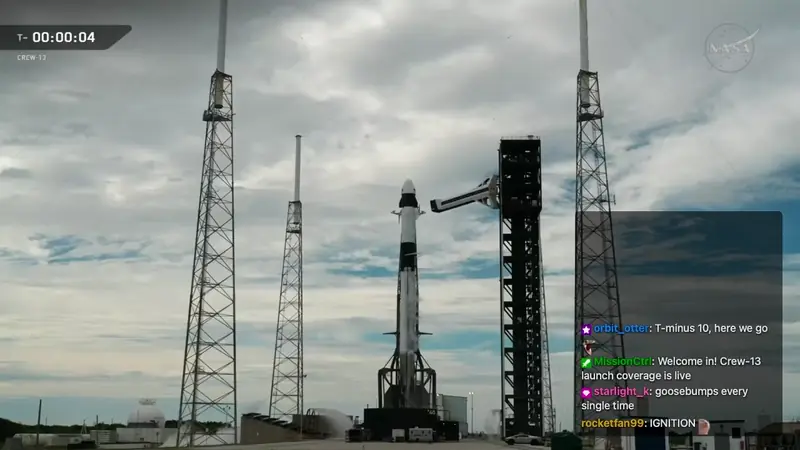
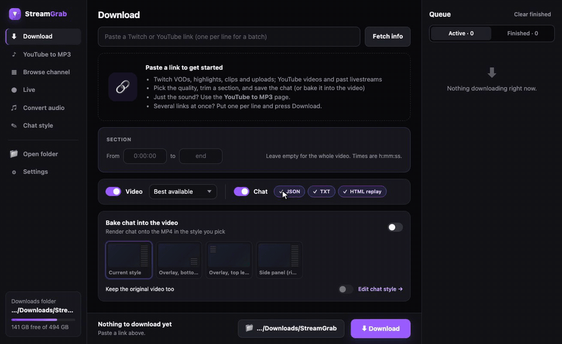

# StreamGrab

Download Twitch and YouTube videos, chat and live streams, and bake the chat right into the video. For Mac and Windows.

**[⬇ Download the latest version](https://github.com/kuriswh0/StreamGrab/releases/latest)**: `.dmg` for Mac (Apple Silicon), Setup `.exe` or portable `.zip` for Windows. Everything it needs is included.



## Features

**Download any part of a VOD.** Twitch VODs, highlights and clips, YouTube videos and past streams, at any quality. Drag across the timeline to grab just a section: the chat-activity graph shows where the action is.


**Bake chat into the video**, or save it as JSON, TXT and an HTML replay that scrolls in sync with the video. Design the look in the style editor: side panel or overlay, fonts, colors, badges, BTTV/FFZ/7TV and animated emotes.



**YouTube to MP3.** Save just the audio as MP3, WAV, FLAC, M4A or Opus, with title, artist and cover art.


**Also:**
- **Live recording** of Twitch and YouTube channels, with Twitch chat. It can wait for an offline channel to go live.
- **Channel browser:** list a channel's broadcasts, highlights or uploads and send them to the Download page.
- **Audio converter:** MP3, AAC, OGG, Opus, WMA, FLAC, ALAC, WAV and AIFF, in batches, keeping tags and cover art.
- **Queue** with progress, cancel, retry and re-render chat. Batch downloads: paste several links.
- **Updates itself:** when a new version is out, click **Update** in the sidebar and StreamGrab downloads it, installs it and reopens (the portable Windows zip gets a download link instead).

<sub>Demo footage: NASA's SpaceX Crew-13 launch (NASA). Chat in the demos is sample chat.</sub>

## Run from source

- Python 3.9+ (standard library only, nothing to `pip install`)
- `yt-dlp` and `ffmpeg` on your PATH:

```bash
brew install yt-dlp ffmpeg
```

Keep yt-dlp current (`brew upgrade yt-dlp`), because YouTube and Twitch change their sites often.

## Mac app

`dist/StreamGrab.app` is a native macOS app: a small Swift/WebKit window (`macos/main.swift`) that runs the Python engine in the background on a free local port. It adds:
- a dock icon
- normal Mac menus and shortcuts (⌘C/⌘V, ⌘R reload, ⇧⌘O to open the downloads folder)
- a native folder picker in Settings
- a warning if you quit while downloads are running

Quitting the app cancels any running downloads. The engine's log is at `~/Library/Logs/StreamGrab.log` (File → Show Log).

Rebuild the app after changing any code:

```bash
macos/build.sh
```

To also copy it into /Applications:

```bash
macos/build.sh --install
```

The app is ad-hoc signed, so it runs on this Mac without warnings. It still needs `python3`, `yt-dlp` and `ffmpeg` from Homebrew on the machine it runs on.

## Mac installer (shareable)

`macos/make_dmg.sh` builds `dist/mac/StreamGrab-1.0.1.dmg`: open it and drag StreamGrab to
Applications. Unlike `macos/build.sh` (which uses Homebrew's tools), this app carries its own
Python 3.14, yt-dlp, Deno (for YouTube) and FFmpeg, so it runs on any Apple Silicon Mac (M1 or later, macOS 12+) with
nothing else installed. It isn't notarized, so the first launch needs **System Settings → Privacy &
Security → Open Anyway** (explained in the DMG). To rebuild: `macos/fetch_vendor.sh`, then
`macos/make_dmg.sh`.

## Windows app

`windows/build.sh` builds the Windows version on this Mac (no PC needed):

- `dist/windows/StreamGrab-Setup-1.0.1.exe`: installer. Per-user install to
  `%LOCALAPPDATA%\Programs\StreamGrab`, no admin rights needed. Adds Start menu and desktop shortcuts
  and an uninstaller in Settings → Apps.
- `dist/windows/StreamGrab-Portable-1.0.1.zip`: unzip anywhere and run `StreamGrab.exe`.

Everything it needs is bundled: Python 3.14 (embeddable), Pillow + fontTools, yt-dlp, Deno (for YouTube) and FFmpeg. The
window is Microsoft Edge in app mode (on every Windows 10/11 PC). Closing it quits the app, after
saving any live recording. Differences from the Mac app:

- Chat is drawn by `chatrender.py` (a Pillow port of the Swift renderer), using Windows fonts with
  Segoe UI Emoji for emoji.
- The "Hardware" bake-in encoder uses NVIDIA NVENC, Intel Quick Sync or AMD AMF, whichever works.
- Stop on a live recording ends yt-dlp at once and saves what was written (Windows can't send it
  Ctrl+C without a console).
- File names are kept shorter (Windows' 260-character path limit).

The icon is the Mac app's artwork, drawn to fill the frame as Windows icons are. It's used for the .exe files, the shortcuts, Settings → Apps and the app window. Regenerate it with `windows/make_ico.sh` if the icon changes.

To rebuild: `windows/fetch_vendor.sh` (downloads the bundled components into `windows/vendor`),
`brew install makensis`, then `windows/build.sh`. The .exe files are unsigned, so Windows SmartScreen
shows "Windows protected your PC" the first time: click **More info → Run anyway**.

## Releases and updates

The version number lives in `VERSION`; the build scripts and the app read it from there.

- **Publish a version:** put the new number in `VERSION`, commit, then tag and push:
  `git tag v1.0.2 && git push origin main v1.0.2`. GitHub Actions (`.github/workflows/release.yml`)
  then builds the DMG on a Mac and the Windows installer + portable zip, tests each package with
  `tests/smoke.py` (the Windows one on a real Windows machine), and publishes a GitHub Release.
  From the Actions tab you can also run it by hand, to build and test without publishing.
- **yt-dlp updates:** every Monday `.github/workflows/update-ytdlp.yml` checks for a new yt-dlp. If
  there is one, it bumps the patch version (1.0.1 → 1.0.2) and publishes a new release with it.
- **In the app:** the engine checks the latest GitHub Release (at most every 6 hours) and the sidebar
  shows an update box. Installed copies (the Mac app and the Windows installer version) update themselves from it: `updater.py` downloads the release file, checks its SHA-256 against GitHub, installs it and reopens the app, and won't run while downloads are active. Portable copies get a link to the download page. **Check for updates** at the bottom of the sidebar asks GitHub right away. Settings shows the current version.

The bundled tools (`macos/vendor`, `windows/vendor`) and the built installers (`dist`) aren't in git;
the workflows download the tools at build time.

## Run without the app

```bash
python3 server.py
```

or double-click `StreamGrab.command`. The UI opens at http://127.0.0.1:8765. Options: `--port 9000`, `--no-browser`.

Downloads go to `~/Downloads/StreamGrab/<channel>/` by default. Change it with the folder button next to **Download** (also on the YouTube to MP3 and Live pages), or in Settings. The folder you pick becomes the new default. Settings are saved to `~/.streamgrab.json`.

## How it works

| Part | File |
| --- | --- |
| HTTP server, job queue, yt-dlp process + progress parsing, channel browsing | `server.py` |
| Twitch chat (GQL API, parallel offset paging), YouTube chat parsing, JSON/TXT/HTML writers | `chat.py` |
| Main UI | `static/index.html` |
| Chat replay page template | `static/chat_replay.html` |
| Chat burn-in: style, layout, BTTV/FFZ/7TV emotes, badges, ffmpeg compositing | `render.py` |
| Parallel segment downloader for trimmed Twitch VODs | `fastdl.py` |
| Live status checks, Twitch live chat recorder (anonymous IRC) | `live.py` |
| Chat panel renderer (draws frames, animated emotes, preview PNGs) | `macos/chatrender.swift` |
| macOS app shell (window, menus, folder picker, engine lifecycle) | `macos/main.swift` |
| App icon renderer / app bundle build script | `macos/make_icon.swift`, `macos/build.sh` |

The server only listens on 127.0.0.1 and rejects requests from other origins.

## Limitations

- **Sub-only and deleted VODs** need a logged-in Twitch account. Login isn't supported yet, so only public VODs work.
- **Twitch chat paging**: Twitch blocks cursor paging for non-browser clients ("failed integrity check"), so chat is paged by time offset. If one second of chat contains more than about 60 messages, a few of them can be missed. In testing, xQc's chat peaked at 15 messages per second.
- **YouTube live chat** isn't recorded during live streams. YouTube VOD chat replays still download.
- **Twitch ads**: during ad breaks, a live recording captures Twitch's ad placeholder screen.
- **Recordings start with buffered footage**: each recording begins with roughly 10–20 seconds of video that Twitch had already buffered. That footage has no chat.
- **Baking chat in needs a re-encode**: about 7× real time for 1080p60 on an M4 Pro (a 2h42m section takes about 22 minutes). Settings → "Baking chat into video" lets you choose:
  - **Fast** (default): uses all CPU cores.
  - **Hardware encoder**: about half as fast, but leaves the CPU free for other work. Apple Silicon has a single encode engine, so running encodes in parallel doesn't speed it up.
- **Trimmed Twitch downloads** fetch only the segments they need, 12 at a time, at up to your line speed. While downloading, they briefly use extra disk space equal to the section's size.
- **Chat renderer requires macOS**: it's written in Swift. When you run `server.py` directly, it's compiled automatically the first time it's needed.
- **No percentage for trimmed YouTube downloads**: yt-dlp downloads these through ffmpeg, which doesn't report progress, so only size and speed are shown.
- **Cancelled downloads** leave `.part` files behind.
- **YouTube "HTTP Error 403"**: YouTube sometimes refuses a download link. StreamGrab retries twice on its own, the second time asking as YouTube's embedded player does. Videos that can't be embedded can still fail; press Retry later.
